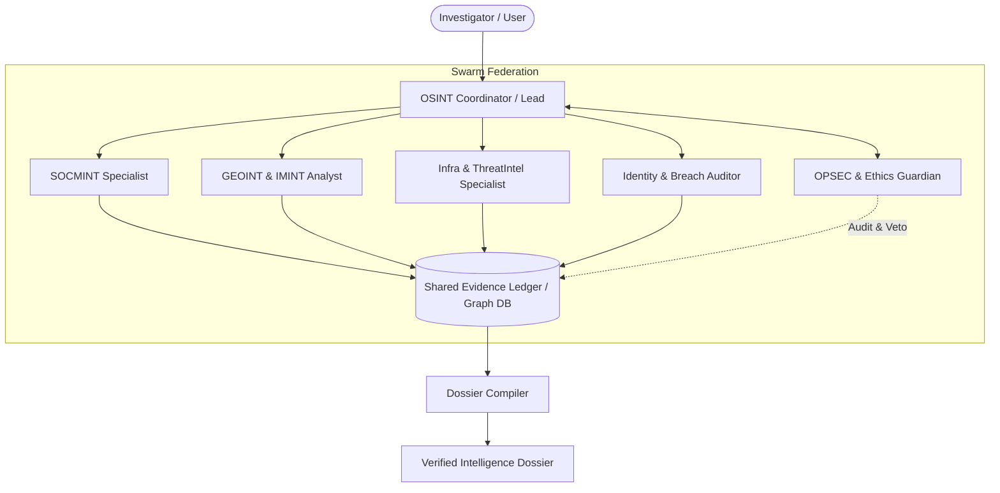

# Multi-Agent OSINT Swarm Architecture
## Roles, Protocols, Evidence Ledgers, and Swarm Orchestration

---

## 1. Overview & Swarm Topology

Autonomous OSINT investigations require parallelization across distinct domains (social graphs, geospatial data, breach records, and network infrastructure) while maintaining centralized evidentiary integrity.

The **OSINT Swarm** is structured as an orchestrated federation of autonomous specialist agents coordinated through a shared **Evidence Ledger** and strict **OPSEC & Chain-of-Custody Governance**.



---

## 2. Agent Roster & Specialist Personas

### 2.1 `osint-coordinator` (Investigative Lead)
- **Role:** Central mission dispatcher, hypothesis generator, and synthesis lead.
- **Responsibilities:**
  - Ingests initial target parameters (seed data) and sets investigation objectives.
  - Maintains the global investigative state tree: which leads are open, active, verified, or discarded.
  - Decomposes high-level questions into granular specialist tasks (e.g., *"Determine if email X belongs to the owner of domain Y"*).
  - Enforces confidence thresholds before accepting nodes into the verified graph.
  - Compiles the final **OSINT Intelligence Dossier**.
- **Model Recommendation:** `pro` or top-tier reasoning model (Gemini 1.5 Pro, Claude 3.5 Sonnet).

### 2.2 `socmint-analyst` (Social Media & Identity Correlation)
- **Role:** Deep social footprinting, online handle tracking, and platform presence enumeration.
- **Tooling Integrations:**
  - `Sherlock`: Account scanning across 400+ platforms.
  - `Holehe`: Zero-touch email registration detection on 120+ services.
  - `Epieos`: Google profile discovery, Google Maps reviews, Calendar links.
  - `WhoCalledMe` & `PhoneInfoga`: Telecom verification and linked social profiles (WhatsApp, Telegram).
- **Core Methodology:**
  - Evaluates handle collisions (distinguishing common usernames from unique alphanumeric pseudonyms).
  - Maps social cross-references (e.g., a Twitter bio linking to a GitHub page or Mastodon instance).
  - Behavioral temporal footprinting (posting time patterns, language dialects, active timezone analysis).

### 2.3 `geoint-imint-analyst` (Geospatial & Visual Forensic Analyst)
- **Role:** Imagery metadata forensics, reverse visual discovery, and spatial triangulation.
- **Tooling Integrations:**
  - `ExifTool` / `ExifData`: Extraction of GPS metadata, camera serial numbers, lens profiles, software versions, and ICC profiles.
  - `TinEye` & `Google Lens / Images`: Image provenance, modification history, original resolution discovery, and identity matching across platforms.
  - `Overpass Turbo` & `OpenStreetMap`: Overpass QL spatial queries for feature triangulation (e.g., architectural landmarks, utility poles, tram tracks, power grids).
- **Core Methodology:**
  - Chrono-location and sun/shadow angle estimation.
  - Feature filtering: street signage, vegetation types, driving side, architectural vernacular, and infrastructure markers.

### 2.4 `threatintel-infra-analyst` (Network & Attack Surface Analyst)
- **Role:** Domain, DNS, IP, SSL certificate, and cloud asset footprinting.
- **Tooling Integrations:**
  - `theHarvester`: Passive search engine harvesting for emails, subdomains, names, and hosts.
  - `Recon-ng`: Structured framework modules for DNS bruteforcing, whois querying, and Netcraft mining.
  - `SpiderFoot`: Multi-source asset enumeration, ASN mapping, and leak detection.
  - `crt.sh` / Certificate Transparency: Discovery of forgotten staging subdomains and development infrastructure.
  - `Google Dorks (GHDB)`: Uncovering exposed S3/GCS buckets, sensitive documents, and directory listings.
- **Core Methodology:**
  - Passive DNS mapping (PTR, A, AAAA, MX, TXT, SOA, SPF/DMARC).
  - Historical infrastructure correlation (historical WHOIS, passive SSL records).

### 2.5 `identity-breach-auditor` (Breach & Public Records Auditor)
- **Role:** Verifies exposure history, historical password reuse, and public records corroboration.
- **Tooling Integrations:**
  - `HaveIBeenPwned` (HIBP API): Exposure timeline, data classes breached.
  - `DeHashed`: Historical credential and identity correlation (email, hashed password, salt, phone, IP, username).
  - `People Directories` (Spokeo, That'sThem, BeenVerified, FastPeopleSearch, TruePeopleSearch, FamilyTreeNow, Yandex People): Public records extraction and address history collation.
- **Core Methodology:**
  - Constructs credential link graphs (e.g., Target uses unique password hash $H_1$ on both Breach A [2018] and Breach B [2021], confirming both records relate to the identical subject).
  - Triangulates public records against corporate/business registry records.

### 2.6 `opsec-compliance-guardian` (Ethics, Legal & Operational Security Guard)
- **Role:** Independent compliance auditor with non-negotiable veto authority over all queries and tools.
- **Responsibilities:**
  - Intercepts all proposed tool commands before execution.
  - Blocks any command classified as **Active Exploitation** (e.g., SQLMap, port scanners against unapproved targets, brute-force attacks, unauthorized credential stuffing).
  - Ensures all network requests utilize proper proxy routing, randomized user-agents, and appropriate rate-limiting.
  - Enforces data minimization: mandates redacting or discarding unrelated third-party private data (minors, non-public medical/financial details).

---

## 3. Evidence Ledger Schema & Inter-Agent Protocols

All agents communicate asynchronously via an append-only JSON/SQLite **Evidence Ledger**. This prevents data duplication and gives every finding a transparent chain of custody.

### 3.1 Entity Node Schema
```json
{
  "entity_id": "ent_9f82d1",
  "type": "IDENTITY_PERSON",
  "canonical_value": "Jane Doe",
  "confidence_score": 0.88,
  "status": "VERIFIED",
  "attributes": {
    "aliases": ["jdoe_sec", "janedoe99"],
    "primary_email": "jane.doe@example-target.com",
    "primary_phone": "+1-555-019-2834",
    "country": "US",
    "state": "VA"
  },
  "first_observed": "2026-11-21T18:00:00Z",
  "last_updated": "2026-11-21T18:15:30Z",
  "discovered_by": "identity-breach-auditor"
}
```

### 3.2 Evidence Record Schema (Chain of Custody)
```json
{
  "evidence_id": "ev_48a17c",
  "target_entity_id": "ent_9f82d1",
  "source_type": "TELECOM_LOOKUP",
  "source_url_or_tool": "phoneinfoga://lookup?number=15550192834",
  "source_reliability": 0.90,
  "raw_data_hash": "sha256:e3b0c44298fc1c149afbf4c8996fb92427ae41e4649b934ca495991b7852b855",
  "findings": {
    "carrier": "Verizon Wireless",
    "line_type": "MOBILE",
    "valid": true,
    "registered_location": "Arlington, VA"
  },
  "opsec_cleared": true,
  "timestamp": "2026-11-21T18:05:12Z"
}
```

### 3.3 Graph Edge Schema (Relationships)
```json
{
  "edge_id": "rel_c7120a",
  "source_node": "ent_9f82d1",
  "target_node": "ent_33b821",
  "relationship": "OWNS_DOMAIN",
  "weight": 0.85,
  "evidence_refs": ["ev_48a17c", "ev_11d29e"],
  "notes": "Domain WHOIS historical contact email matches canonical email from breach correlation."
}
```

---

## 4. Swarm Message Board Protocols

When running within **Google Antigravity Swarms** or peer-to-peer message boards, agents interact using structured tag-based posts:

### 4.1 Dispatching a New Investigative Pivot
```markdown
@socmint-analyst
[ACTION_REQUIRED: USERNAME_ENUMERATION]
Seed Entity: ent_9f82d1 (Jane Doe)
Candidates: ["jdoe_sec", "j_doe88"]
Objective: Enumerate presence across developer, technical, and gaming platforms.
OPSEC Level: PASSIVE_ONLY (Do not trigger target notifications).
```

### 4.2 Posting Evidence & Requesting Corroboration
```markdown
@osint-coordinator @geoint-imint-analyst
[EVIDENCE_POSTED: MEDIA_DISCOVERED]
Discovered Avatar: avatar_hash_8a88.jpg
Source: GitHub profile "jdoe_sec"
Action Requested for GEOINT:
1. Run ExifTool on extracted raw asset.
2. Search Google Lens / TinEye for original high-resolution non-cropped version.
3. Check for location-identifying architectural background features.
```

### 4.3 OPSEC Violation Intercept
```markdown
@threatintel-infra-analyst @osint-coordinator
[OPSEC_VETO: DIRECT_ACTIVE_PROBE_BLOCKED]
Attempted Command: nmap -sV -p 1-65535 target-domain.com
Reason: Active port scanning without explicit target authorization violates passive OSINT engagement rules.
Approved Alternative: Query Shodan / Censys passive caches or examine crt.sh certificate history.
```

---

## 5. Deployment Configurations

### 5.1 Google Antigravity Swarm Configuration
- Initialize coordinator: `swarm action:"title" title:"OSINT Intelligence Swarm"`
- Spawn specialists:
  - `swarm action:"add" name:"socmint" brief:"Conduct SOCMINT, account discovery, and handle correlation."`
  - `swarm action:"add" name:"geoint" brief:"Perform image metadata extraction, reverse image matching, and OSM triangulation."`
  - `swarm action:"add" name:"infra" brief:"Gather passive DNS, subdomains, certificates, and infrastructure footprints."`
  - `swarm action:"add" name:"breach" brief:"Audit credential exposures, HIBP records, and public registries."`
- Real-time updates posted directly to the shared message board.

### 5.2 Hermes Agent Framework Configuration
- Driven by a central orchestrator workflow (`workflow.py`) calling sub-agents via RPC or tool-delegation.
- Local persistence maintained in `./workspace/cases/<case_id>/` with `nodes.json` and `edges.json`.

### 5.3 Claude Code Configuration
- Implemented as a specialized skill (`/osint`) leveraging bash tooling, subprocess CLI wrappers (`sherlock`, `holehe`, `phoneinfoga`, `exiftool`), and structured memory in `.claude/osint_memory.md`.
